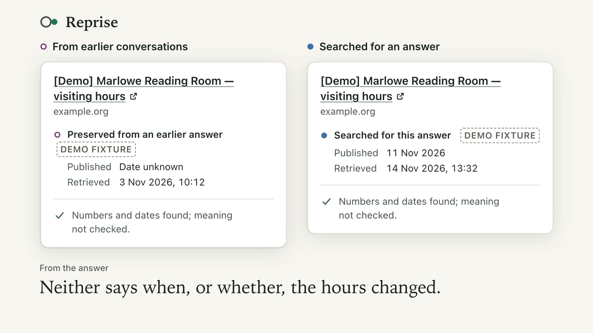
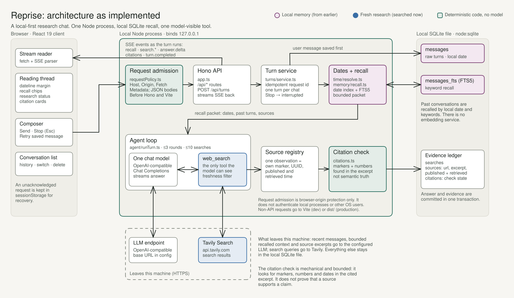

# Reprise

A local chat agent for **what we discussed then, and what we can verify now**: it remembers your past conversations, resolves dates like "last Tuesday" in code, and checks fresh web evidence with one bounded search tool.

Every answer keeps its sources as dated observations, so an earlier reading and a fresh one stay visibly separate. Reprise is implemented and engineering-verified; real-model quality was evaluated once and its known limits are documented, not hidden.

[Quickstart](#quickstart) · [Try Reprise](#try-reprise) · [Verify](#verify) · [How it works](#how-reprise-works) · [DESIGN.md](DESIGN.md)

## Reprise in action

<video src="docs/assets/reprise-demo.mp4" poster="docs/assets/reprise-demo-poster.jpg" controls muted playsinline width="100%">
  <a href="docs/assets/reprise-demo.mp4"></a>
</video>

*A 22-second silent film of the real interface ([MP4, 2.4 MB](docs/assets/reprise-demo.mp4)). It is a scripted demonstration: the model and the search provider are scripted fixtures, every source is an invented `[Demo]` page, and no live provider was called.*

## What makes it different

- **Memory is yours and local.** Past conversations live in a local SQLite file. Supported English dates (`3 November`, `yesterday`, `last Tuesday`) are resolved in code, in your timezone, and recall uses local-date indexes plus FTS5 keywords. There is no embedding service.
- **One bounded tool.** The model can see exactly one tool, `web_search`, backed by Tavily: three rounds, five queries per round, ten per turn.
- **Every source is a dated observation.** Each retrieval gets its own marker, UUID, publication date (when known) and retrieval time. A page seen earlier and the same page seen now stay two observations: a hollow ring marks "from earlier", a filled dot marks "searched for this answer", and demo fixtures are labelled.
- **A check is only a check.** Citation verification looks for markers, numbers and dates in the cited excerpt. The card says so: *"Numbers and dates found; meaning not checked."* It does not prove that a source supports a claim.
- **Streaming with Stop and Retry.** Answers stream over server-sent events, Stop or Esc interrupts, and Retry reuses the saved question while preserving earlier attempts.

## How Reprise works



The diagram is drawn from the implementation, and each box names the file it stands for. Editable source: [`docs/diagrams/reprise-architecture.excalidraw`](docs/diagrams/reprise-architecture.excalidraw) (open it at [excalidraw.com](https://excalidraw.com)). On a narrow screen, [open the diagram full size](docs/assets/reprise-architecture.svg). PNG fallback: [`docs/assets/reprise-architecture.png`](docs/assets/reprise-architecture.png).

A request is admitted by a local policy before Hono or Vite sees it. The turn service saves the question first, then code resolves dates and recalls earlier turns from SQLite. One model, with one tool, researches and writes; each result becomes a new observation, citations are checked mechanically, and the answer and its evidence are committed in one transaction while events stream to the browser.

**Citation verification checks bounded mechanical evidence properties. It does not prove general semantic truth.**

## Quickstart

```bash
git clone https://github.com/marsh15/Reprise.git
cd Reprise
nvm install && nvm use        # Node 24 or newer; 24 is pinned in .nvmrc
npm install
cp .env.example .env
```

Edit `.env` and set the two required values:

| Variable | Required | Default | Purpose |
|---|---|---|---|
| `LLM_API_KEY` | **yes** | none | Key for the model endpoint |
| `TAVILY_API_KEY` | **yes** | none | Key for web search |
| `LLM_BASE_URL` | no | `https://api.openai.com/v1` | Any OpenAI-compatible Chat Completions endpoint |
| `LLM_MODEL` | no | `gpt-6-luna` | The runtime model |

Then:

```bash
npm run dev
```

Open <http://localhost:5173>. `npm run dev` runs a preflight first: it checks Node, built-in SQLite, FTS5 and that both keys are non-empty. It does **not** validate the keys; `GET /api/health` reports readiness only. If `.env` is missing it creates one from the template and stops with a message naming the keys to fill.

### Two ways to use this repository

**Path A: inspect the code and verify offline. No provider calls, no cost.** `npm install` and the commands in [Verify](#verify) need no credentials. `npm run seed:demo` also works without any keys. Starting the server does require both keys to be non-empty; with placeholder values the interface loads and you can browse seeded history, but answers cannot be generated.

**Path B: run real conversational research.** This needs a valid key for the configured model endpoint and a valid Tavily key. Provider usage is billed to those accounts. Reprise ships no keys; never commit your `.env`.

<details>
<summary>Every setting, and production mode</summary>

Every supported environment setting is in [.env.example](.env.example). Shell values take precedence over `.env`. Secrets are server-side; never prefix them with `VITE_` or commit them.

- **Model:** `LLM_REASONING_EFFORT` is optional (`none`, `low`, `medium`, `high`). The compatibility guard applies `none` for Luna tools and rejects Terra's Responses-only tool pairing on this Chat Completions path. Verify actual account/model compatibility with `npm run smoke:llm`; endpoint compatibility alone is insufficient.
- **Local:** `PORT=5173`, `REPRISE_DB_PATH=./data/reprise.db`, `LOG_LEVEL=info` (`debug`, `warn`, `error` also supported).
- **Testing only:** `REPRISE_NOW` freezes the clock to an ISO timestamp with offset. Startup and the UI warn when active; leave it unset for real conversations.
- **Optional evaluations only:** `OPENROUTER_API_KEY`, with explicit endpoint/model/US-provider selection described in the [evaluation guide](evals/README.md).

For a production build, keep dev dependencies installed (the server entry uses `tsx`):

```bash
npm run build
npm start
```

Run one server per database file. The server binds to `127.0.0.1`.

</details>

## Try Reprise

A fresh database has no history, so Reprise ships a clearly labelled demo seed. Seed **before** starting the server (one process per database file):

```bash
npm run seed:demo -- --tz Asia/Kolkata     # use your own IANA timezone
npm run dev
```

Seeding adds four `[Demo]` conversations (CRM, Postgres hosting, Node/Bun and weekend plans), dated relative to today and tagged `DEMO` in the interface. It never runs automatically, and repeating it refuses to duplicate them. Fixture prices are invented controls, not vendor facts.

1. **Recall.** Click or type *"What did we talk about yesterday?"* Reprise resolves "yesterday" in code and shows a recall chip pointing at the original demo message. The recall is local; writing the answer needs the model key.
2. **A related question.** Ask *"On Monday we shortlisted five CRM tools. Has pricing changed since?"* The chip links the earlier demo conversation and carries the `DEMO` badge.
3. **Fresh research (Path B only).** With valid keys the model can run `web_search`. Expand the research summary, then open a citation: the card separates *Preserved from an earlier answer* (hollow ring, its retrieval date) from *Searched for this answer* (filled dot, its publication and retrieval dates). Two readings that differ are an **observed difference**; they do not prove when, or whether, the underlying fact changed.

`npm run seed:demo -- --tz Asia/Kolkata --reset-fixtures` replaces the fixture conversations. It **deletes entire fixture conversations**, including any messages you added to them, and preserves all other conversations.

<details>
<summary>Using the interface</summary>

Create or switch conversations in the sidebar. Enter sends, Shift+Enter adds a newline, and Stop or Esc interrupts. Switching conversations disconnects the current stream. Reload retrieves saved history; Retry uses the saved user message and preserves previous attempts. An unacknowledged request is temporarily retained in browser session storage for recovery. Conversation deletion removes its history and evidence after confirmation.

Expand the research summary to see queries, failures and sources. Hover or focus a citation to inspect publication/retrieval dates, historical versus current observations and fixture labels. Dotted citations indicate unsupported numerical/date tokens or an explicit source-subject mismatch; an invalid marker has no registered source. **A numerical check is not semantic verification.** Each new observation has its own marker, even for a previously retrieved URL. Inspect the actual excerpt and observation date; a matching number still does not establish meaning or correct attribution.

Recall chips open the original message. Supported English dates include `3 November`, `yesterday` and `last Tuesday`; numeric dates such as `3/11` are excluded. Date arithmetic uses the request timezone; stored local dates retain their original timezone interpretation. Ambiguity assumptions and missing-history information go to the model before it answers.

</details>

## Verify

```bash
npm run typecheck
npm test
npm run build
npm run eval -- --mock
npm run eval -- --mock --only R1,R2,R3
REPRISE_TEST_PRODUCTION=1 npx vitest run tests/integration/server.test.ts
```

None of these call a provider. `typecheck` validates the TypeScript; `npm test` exercises the engineering behaviour against deterministic local fakes; the mock evaluations run scripted scenarios against synthetic evidence. **A mock pass shows that the harness and the orchestration work. It is not evidence that a real model answers correctly.**

These commands were last run end to end in a fresh clone on Node 24.22.3 and npm 11.19.1 at release commit `7563d6b`: 748/748 tests, 23/23 scripted mock scenarios, 3/3 for `R1,R2,R3`, with typecheck and build passing. The [final release report](docs/FINAL-RELEASE.md) is the record.

With provider access (these spend credits on your accounts):

```bash
npm run smoke:llm
npm run eval                            # real LLM + checked-in synthetic search replay
npm run eval -- --live --only C1,D1,F1  # real LLM + real Tavily smoke subset
```

The [evaluation guide](evals/README.md) covers scenarios, capture/replay and human review. Generated reports stay in ignored `evals/results/`. A live subset is not full acceptance, and checked-in search cassettes are synthetic.

**Known issue.** If the checkout path contains the word `private` (on macOS, `/tmp` resolves to `/private/tmp`), one test in `tests/integration/security.test.ts` ("serves the client and HMR runtime but no private workspace files") fails. It asserts that Vite's 403 page does not contain the word `private`, and that page echoes the blocked file's path. The 403 is correct and the product is unaffected; the test is just sensitive to the path. Clone into a normal location such as your home directory and the full suite passes.

## Technical decisions

- **Code, not the model, owns calendars and retrieval.** Date arithmetic and recall are reproducible and inspectable; the cost is that keyword recall can miss paraphrases.
- **Raw messages are authoritative.** Summaries never replace what was said, and a fresh retrieval never overwrites an old observation.
- **Publication, retrieval and effective dates stay separate.** A newer retrieval does not make an old page current.
- **One tool, one model, no framework.** No router, multi-agent pipeline, embeddings, second-model verifier or agent framework: each adds calls and failure points without demonstrated benefit here. Built-in `node:sqlite` avoids a database service.
- **Honest verification.** The citation check is lexical and excerpt-only by design, and the interface states what it did and did not check.

The one-page design is [DESIGN.md](DESIGN.md); decisions are recorded in [docs/adr/](docs/adr/).

## Privacy, security and limitations

Reprise is a single-user local app without authentication. The server binds to `127.0.0.1`, and a request admission policy runs before the API and the Vite middleware: it rejects foreign `Host` headers, cross-origin browser requests and non-JSON bodies. That is **browser-origin protection only**. It does not authenticate other local processes or other operating-system users on the same machine. New database files are created with private permissions, and assistant Markdown never loads remote images. See [docs/SECURITY-HARDENING.md](docs/SECURITY-HARDENING.md).

The configured LLM receives recent messages, bounded recalled conversations, an index and source excerpts; Tavily receives search queries. History is local SQLite data, but generation sends that context to the provider. There is no telemetry. Back up the database before manual repair; corrupt or newer databases are rejected. `.env`, local data, builds and generated reports are ignored.

**Model quality.** The runtime model is `gpt-6-luna`, a practical choice, not a benchmark winner. Real-model evaluation was run once per scenario and did not pass every scenario. Known limits include occasionally omitted source qualifiers, a demo record occasionally left unlabelled, and derived differences without operand citations. See [FINAL-ACCEPTANCE](docs/FINAL-ACCEPTANCE.md) and [FINAL-RELEASE](docs/FINAL-RELEASE.md).

**Behaviour limits.** Research is limited to three rounds, five queries per round, ten per turn, eight seconds per search and a 25-second research deadline; the final answer stream has a separate provider timeout. Change classifications and no-search decisions are prompted model behaviour, not deterministic guarantees. Keyword recall can miss paraphrases; context is bounded; excerpts can omit decisive facts. Refresh interrupts rather than resumes a stream. A hard process crash can lose the in-flight answer and evidence while retaining the saved question.

## Documentation

[DESIGN.md](DESIGN.md) · [PRODUCT.md](PRODUCT.md) · [DESIGN-UI.md](DESIGN-UI.md) · [final release](docs/FINAL-RELEASE.md) · [final acceptance](docs/FINAL-ACCEPTANCE.md) · [acceptance remediation](docs/ACCEPTANCE-REMEDIATION.md) · [security hardening](docs/SECURITY-HARDENING.md) · [evaluation guide](evals/README.md) · [architecture diagram source](docs/diagrams/reprise-architecture.excalidraw) · [glossary](GLOSSARY.md) · [decisions](docs/adr/) · [correctness checkpoint](docs/CORRECTNESS-REVIEW.md)
